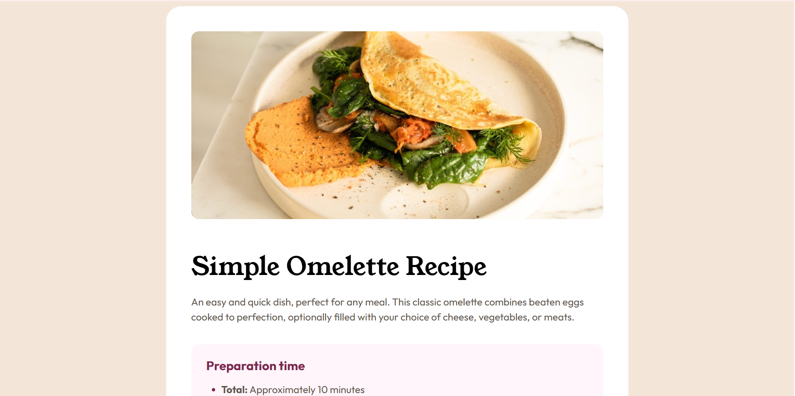

# Frontend Mentor - Recipe page solution

This is a solution to the [Recipe page challenge on Frontend Mentor](https://www.frontendmentor.io/challenges/recipe-page-KiTsR8QQKm). Frontend Mentor challenges help you improve your coding skills by building realistic projects.

## Table of contents

- [Overview](#overview)
  - [The challenge](#the-challenge)
  - [Screenshot](#screenshot)
  - [Links](#links)
- [My process](#my-process)
  - [Built with](#built-with)
  - [What I learned](#what-i-learned)
  - [Continued development](#continued-development)
  - [AI Collaboration](#ai-collaboration)
- [Author](#author)

## Overview

### Screenshot

### Links

- Solution URL: (https://github.com/viveevu11/recipe-page)
- Live Site URL: (https://recipe-page-three-murex.vercel.app)

## My process

### Built with

- Semantic HTML5 markup
- CSS custom properties
- Flexbox
- CSS Grid

### What I learned

I learned that using ::marker lets me apply styles to bullets and numbers of lists. I also learned how to create my first html table through this project.

### Continued development

I want to continue focusing on making the adequate structure choices so that my page looks readable and accessible.

### AI Collaboration

Copilot aided me in debugging layout issues and explained those topics well.

## Author

- Frontend Mentor - [@viveevu11](https://www.frontendmentor.io/profile/viveevu11)
